# Astreus Station Phase IIa (`ES-10a`)

[home](../../README.md)

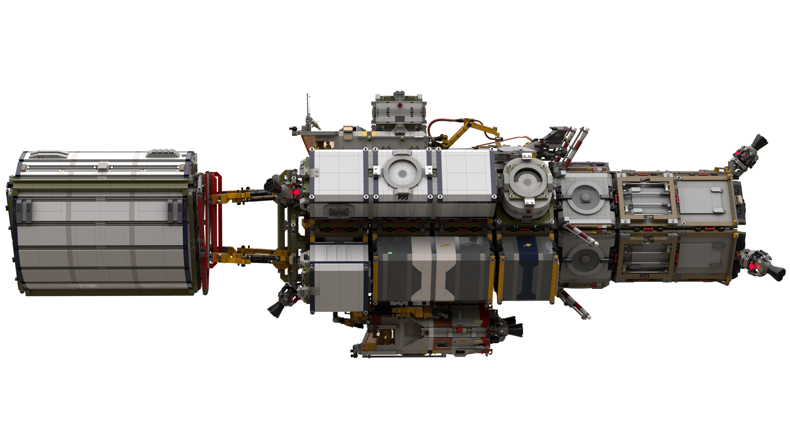

## LSS Castor (Extender Neo X)
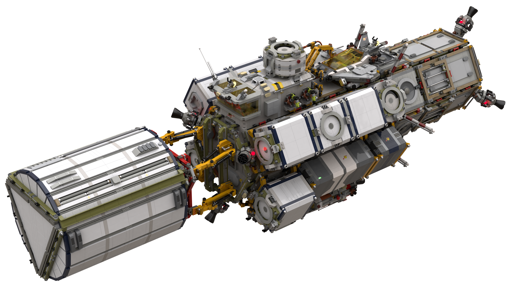

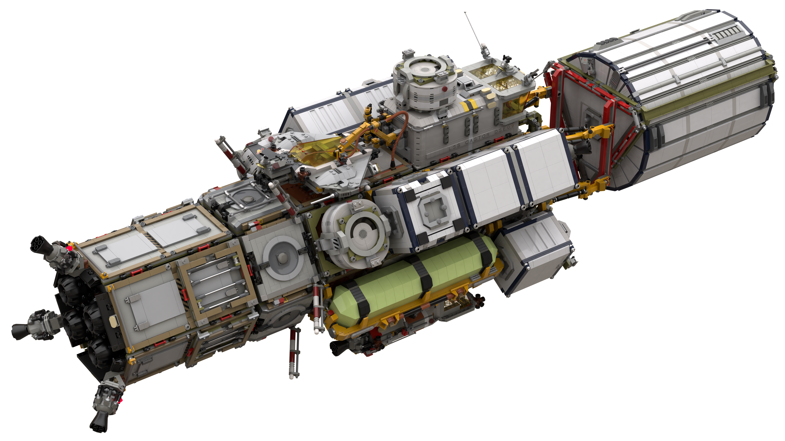

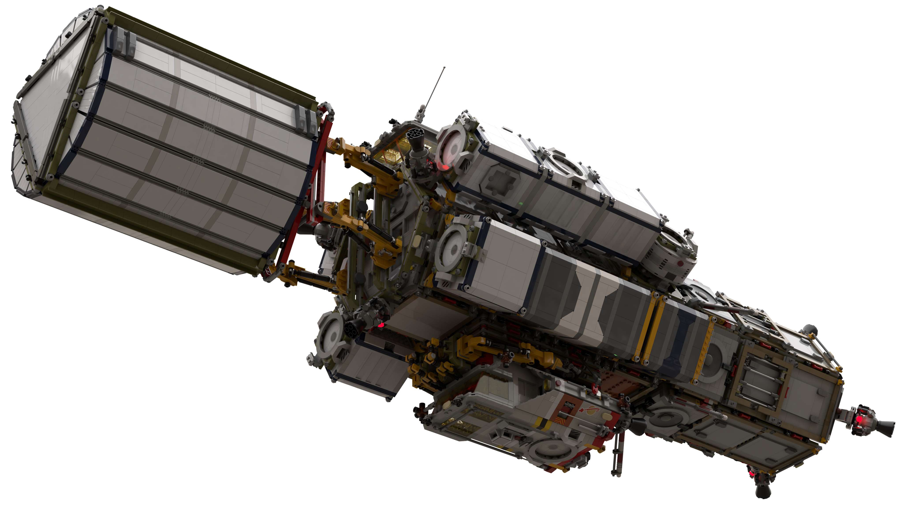

## Spin Gravity Habitat Installation
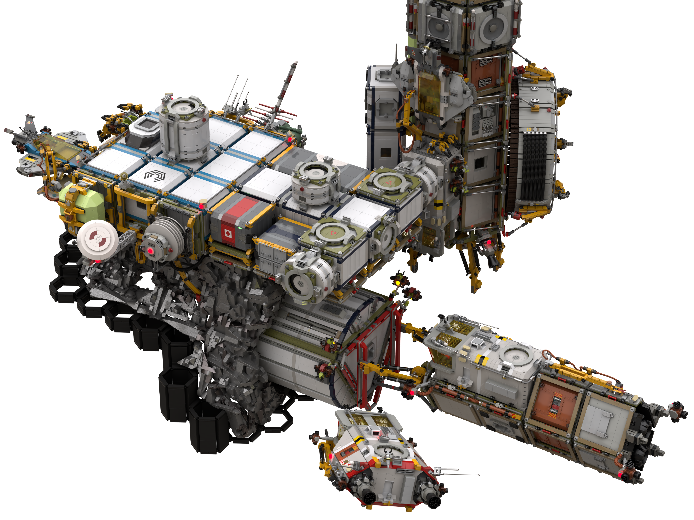

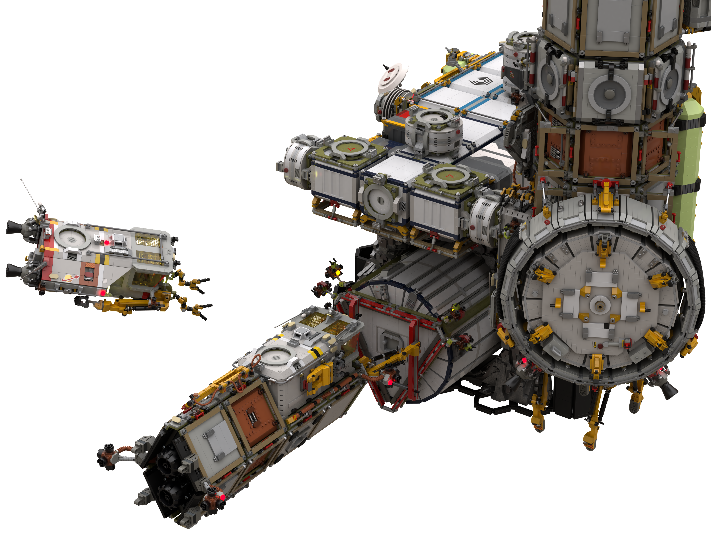

## Station Panoramas
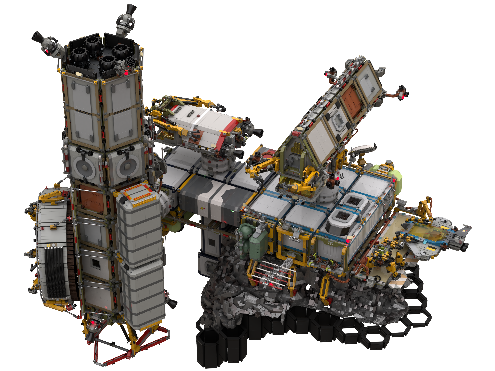

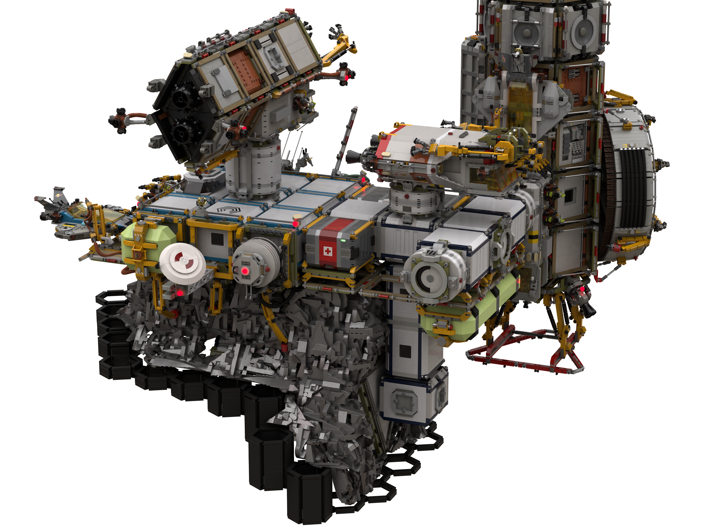

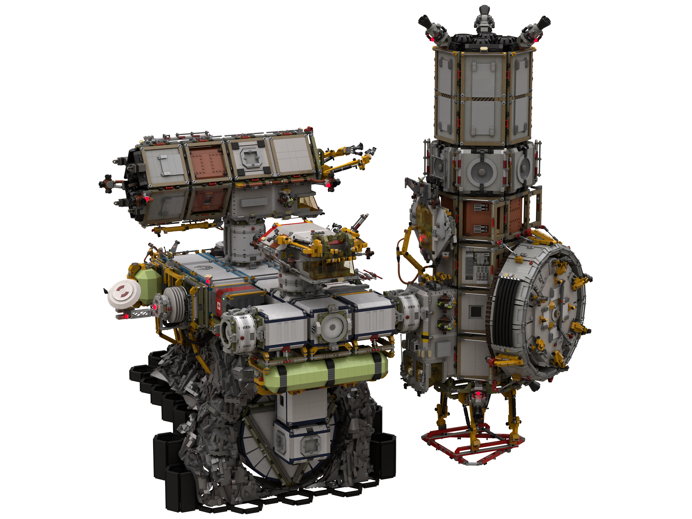

## Extender Neo X - Clean
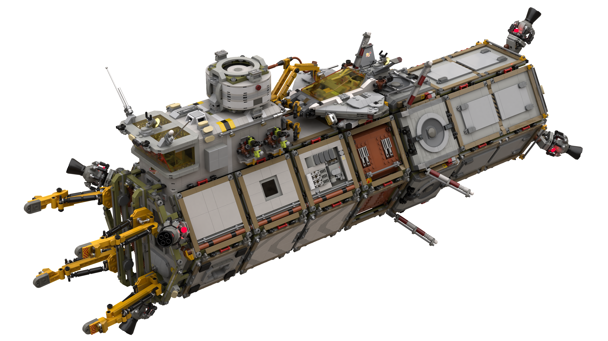

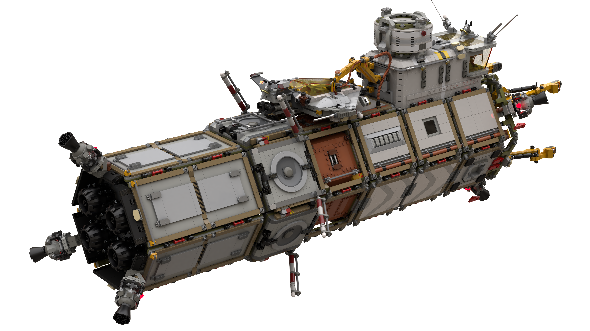

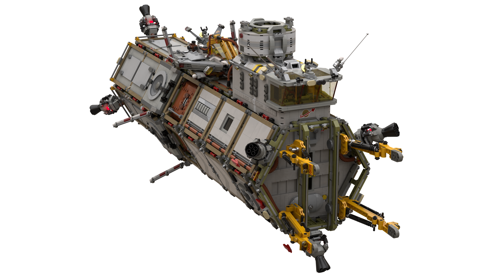

## Tug Neo - Clean
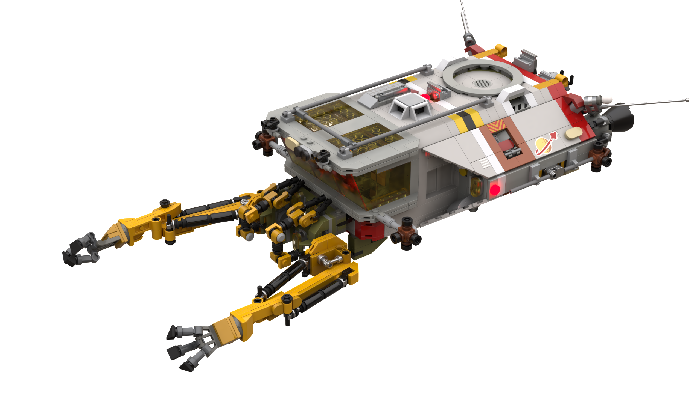

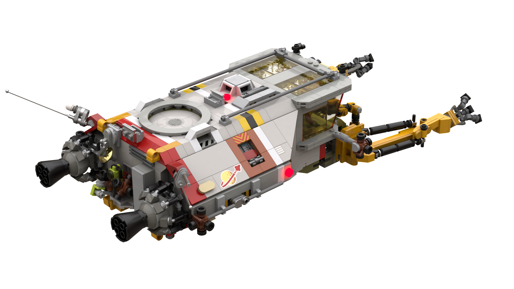

[home](../../README.md)
